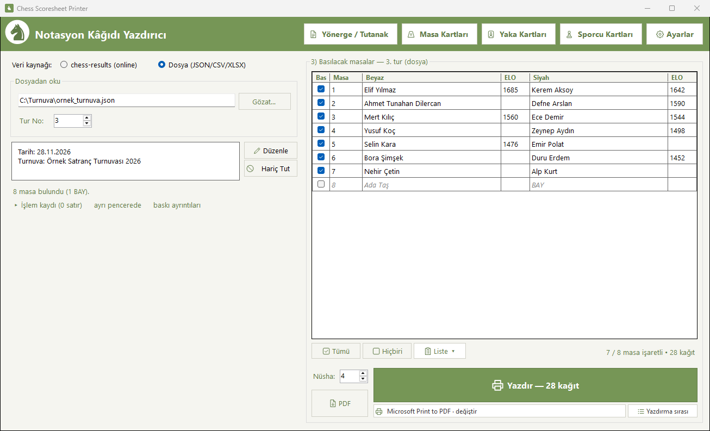
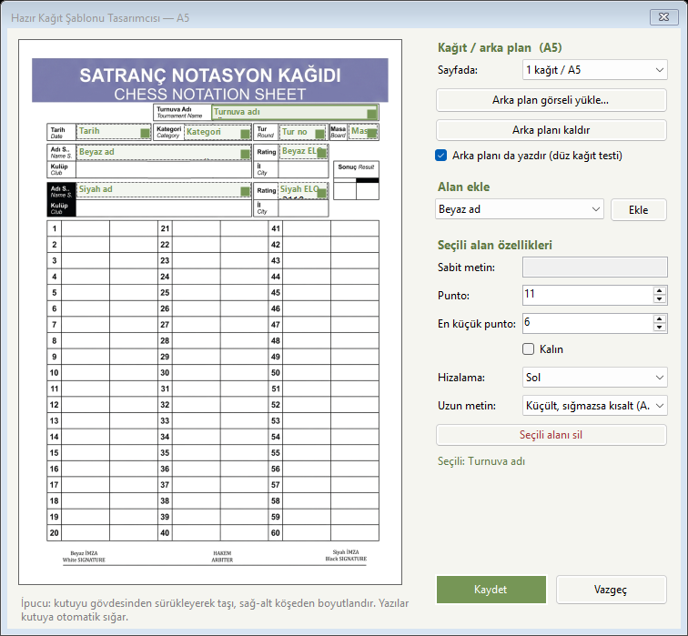

# Chess Scoresheet Printer

[Türkçe](README.md) | English

Chess Scoresheet Printer is a Windows desktop tool for placing tournament pairing information on pre-printed chess scoresheets. It works with Chess-Results and Swiss-Manager exports.

The application is used at tournaments run by two provincial organizations of the Turkish Chess Federation. It is an independent project and is not an official application of the federation.

  

## Main functions

- Search tournaments and retrieve pairings from Chess-Results (byes and unpaired players are recognised)
- Per-category system support: Swiss, round robin (Berger) and team tournaments, read from each category's "tournament type"
- Team matches: board numbers such as "1.2" and team names (printed in the Club boxes)
- Each player's province in the sheet's "İl / City" box: the tournament registration list on the province's TSF website is fetched once at the start and stored, then matched to Chess-Results players allowing for Turkish letters, name order, missing middle names and players with the same name
- Quick-access buttons showing each category's latest round and printing it in one click (F5 refreshes them all)
- A4 lists for the hall notice board: each category's latest pairings (boards, players, ratings, points before the round, round time) and the latest round with results together with the standings after it; small per-category buttons plus "All" (one page per category)
- Arbiter pairing sheets (Ctrl+H): larger type than Swiss-Manager output, a bold result box on every board, a large bold category name and round above each category; categories go on separate pages, share an A4 when they fit, or follow page groups you choose (e.g. three categories on one page, two on the next); font size selectable, page-by-page preview; for round-robin (Berger) categories all rounds can be printed at once (board numbers do not change between rounds). Optional penalty report form (name, date, board, move, round, reason, penalty given; arbiter name and signature): at the bottom of every page, at most half a page, below a faint dashed fold line, or on separate pages, blank or pre-filled with the ticked categories' players for the printed rounds (board, name, round), optionally two forms per A4 to cut in half. Form rows are 1.2 cm high for handwriting
- Before a tournament is on Chess-Results (no pairings yet, even after registration has closed) the players on the TSF registration form are listed in the "boards to print" area, grouped by category (with player and board counts) or in registration order, with name, FIDE and national rating, province and category
- Bye boards are not printed by default, only when ticked manually in the list
- Tournament regulations, report and technical-meeting minutes: built-in templates or your own .docx are filled with Chess-Results data and the regulations published on the province's TSF website; every field is edited in one table; output as PDF, to a printer or as Word
- Official time-control suggestions by tempo (standard, rapid, blitz)
- Schedule and category checks against the TSF competition-regulations procedure: minimum time between round starts by tempo (e.g. 35+30 → 150 min), rounds per day (4 for national rating, 3 for FIDE; 90+30 and 2 per day with a 2400+ player), 12-hour day limit, check-in window (30–60 min), system and rounds by number of players, the same tempo across categories, "and under" categories ending on an even age; "suggest schedule" computes round times
- Category table cards (A4 landscape): tournament poster at the top, large category name below; one theme colour per category with two styles (coloured text on white, or white text on a coloured band); poster cropping tool (card slot, 16:9, 4:3, 1:1 or free) and an edge-to-edge full-width option; embedded fonts (Montserrat, Oswald, Inter); the category name uses one common size on every card, the largest that fits all; copies default to the category's board count
- Arbiter badges (85×54 or 90×60 mm landscape, 2×5 / 2×4 per A4, or large 95×135 mm portrait, 2×2 per A4, fits an A6 holder; with crop marks): logo, photo, name, role and a grade-coloured strip
- Athlete badges (95×135 mm, 2×2 per A4) and table name plates (190×64 mm, 3 per A4, or 190×68 mm, 4 per A4): tournament poster on top, name, category, school / club / province; two round logos and a strip cut from the poster's bottom band on badges, UKD and ELO boxes on plates. The list comes from Chess-Results (ELO, UKD and province matched with the TSF registration list), from the TSF registration list or from Excel (the "Veri_Listesi" sheet of the old printing workbooks)
- Printer settings: target printer, tray, copy count, the printer's own preferences (quiet mode, quality) and "print directly" without preview
- Install and update: the program is installed once (desktop and Start menu shortcuts, removable from Settings → Apps). On start (once a day) it checks for a new version; the "⬆ New version" button downloads only the changed parts (usually a few MB) with a progress bar, verifies them and restarts into the new version. Settings, templates and output stay in %APPDATA%\ChessScoresheetPrinter; updating or uninstalling does not touch them
- Import JSON, CSV, TXT and XLSX files
- Choose the boards to print by ticking them in a list (remembered separately for each category and round)
- Batch-print by round or category
- Create print templates for pre-printed scoresheets
- Adjust field positions and text sizes
- Printer alignment offset (mm) with an alignment test page
- Configure excluded boards, copy count and page size
- Print preview with a faded scoresheet background, and PDF output

## Usage

1. Select a Chess-Results tournament or open a pairing file. Choosing a province lists only tournaments that ended in the last two weeks, are running or are upcoming (older ones are found by name or opened by number); tournaments open for registration on the province's TSF site but not yet on Chess-Results appear at the top: still open as "📋 Kayıtta: … — 32 sporcu", recently closed as "📋 Kayıt bitti (23.10): …" (state and player count are read from each form page). If the computer's DNS server cannot resolve the TSF site, its address is looked up over DNS-over-HTTPS (Cloudflare, else Google; only the site name is sent). For such a tournament the categories and player counts come from the TSF registration form and table cards can be printed from them; once the tournament is published on Chess-Results the same registration list is attached to it automatically. Choosing a province opens its most recently added tournament automatically; search and link/number also work. If **Settings → Default province** is set, it is selected when the program starts. In the province list, typing a letter jumps to the first province starting with it and pressing it again moves to the next.
2. Select the category and round. Pairings load into the list on the right automatically; the default round is the latest round with published pairings (for round robins, the first round without results). A quick-access button (e.g. "🖨 7 Yaş · T2") sends that category's latest round straight to printing. Press F5 after a new round is published to refresh every button.
3. Untick boards that should not be printed and set the number of copies (default 4). Selections are remembered, and "All categories" and the quick-access buttons respect them.
4. Press **Print** (Ctrl+P) to open the preview. The pre-printed sheet is shown faded in the preview but is never printed. Choose a printer and print; selections and filters stay as they were.

The **📄 Yönerge / Tutanak** button in the header takes tournament details from Chess-Results (dates, venue, system, time control, categories, director, arbiters, round schedule) and also finds the regulations on the default province's TSF website (e.g. isparta.tsf.org.tr), reading the registration deadline, contact details, organiser and opening times. Built-in templates are the regulations, the technical-meeting minutes and the end-of-tournament report. The end-of-tournament report takes each category's final standings from Chess-Results and fills in participation and rounds played per category, total players and number of provinces, the province distribution (from the TSF registration list), the top three of each category and, as an annex, the full final standings; values entered for a tournament carry over to its minutes. All fields are edited in one table with their source shown. Your own .docx templates may use `{{IL}}`-style markers, Word bookmarks, content controls or labelled table cells; formatting, tables and locked regions are preserved. "Preview and print" shows the document page by page before printing; printing and saving as PDF are done from the preview. **✏ Önizle ve Düzenle** (preview and edit) shows the document in full page layout as Word renders it: fields to fill are highlighted (empty ones show a placeholder such as "[Telefon]"); click a field and type directly (Enter confirms, Tab moves to the next field, F3 jumps to the next empty one). Cells of the category, schedule and other tables are edited in place too; **Ctrl+Z** undoes the last change and **Ctrl+Y** redoes it. Headings, logos and the template's fixed text are locked. After each change the page is re-laid out by Word in about a second; edits also update the field table, and printing, PDF and Word export are available from this screen. Converting to PDF, preview and printing require Microsoft Word; without Word the document is saved as .docx. Built-in templates: regulations, technical-meeting minutes, end-of-tournament report, penalty report, appeal report and arbiter duty list. Penalties and appeals are recorded in **📝 Ceza / itiraz kayıtları** (players are looked up from the pairing by category, round and board) and fill the penalty and appeal reports and the end-of-tournament evaluation. **📦 Tutanak paketi** saves the chosen documents as PDFs in one go. Your own templates need no markers: dotted blanks such as "Appellant : ………" and "label | empty cell" rows become questions (known labels such as tournament name, date, venue and chief arbiter fill themselves; signature blanks are left alone). **📋 Kullanılabilir alanlar** lists every {{…}} marker and the arbiter, player, pairing, penalty and appeal tables with this tournament's values.

**📋 Pano listeleri** (below quick access) has two rows: "Eşleştirme" buttons show each category's latest paired round ("Açık T5") and "Sonuç" buttons the latest round with results; each prints that list on A4, the results list followed by the standings after that round. "★ Tümü" prints every category, one page each. The **📋 Liste** menu under the board list prints the pairings or results of the category and round currently shown (older rounds too). Team events are grouped by match. Shortcuts: **Ctrl+E** pairings list, **Ctrl+R** results list (for the round shown).

After F5, categories with a newly paired round or newly entered results flash orange for a few seconds and the status line names them ("Yeni eşleştirme: 12 Yaş T6"). The activity log at the bottom left is collapsed by default; open it with the "▸ İşlem kaydı" link (shown in red when there are warnings).

The **registration list and provinces** are fetched automatically when a tournament is opened: the tournament's registration form is found on the province's TSF website and the list is kept, so it remains available after registration closes. The window is opened from **⚙ Settings → Region → 📋 Registration list and player provinces** or by double-clicking the İl column of the pairing list, to choose another form, refresh the list or correct a province. The right form is identified by its players: each form's registrants are compared with the Chess-Results list ("38/44 players in this tournament") and only matching forms are ticked; attaching a form whose players do not match asks for confirmation. A list fetched while another tournament was open is attached automatically when its title matches this tournament. If the TSF site is unreachable, a previously fetched list is used. Players are matched to the Chess-Results starting list: exact name matches, "similar" ones (missing middle name or a one-letter difference, yellow), "ambiguous" ones (same name registered from different provinces, orange, left blank) and players not found (grey). A sibling with the same surname but a different first name is never matched; rating and age category separate players with the same name. Provinces can be corrected in the table, and learned provinces are suggested in later tournaments. The province is printed in the "İl / City" box of the built-in templates.

Table-card copies follow the number of players in the TSF registration list (boards = players ÷ 2; "15 Yaş Genel" and "15 Yaş Kız" count separately), falling back to the Chess-Results board count. **🏷 Masa Kartları** prints an A4 (landscape by default) card for each category. Each category gets its own colour, which is remembered; background and text colour can be changed in the table. The header takes only as much room as its content (poster or tournament name starts at the top of the page; the rest goes to the category name). Cards carry the Ministry of Youth and Sports emblem and the TSF province logo (both round, same size); the province is the one in Settings, and Settings → Region → Logo can switch to the general TSF logo (province logos are generated in the program, the province name drawn on the lower arc in the official lettering). In **🎨 Card design** the logos are dragged on the card and resized with the mouse wheel, snapping to the poster edge, the page centre and the margins. Presets: both sides of the header, centred on the poster edge, both sides of the poster edge, top or bottom corners; a single logo is centred. Text never overlaps the logos. The selected province's logo also appears in the top-left corner of the main window and, when no logo file is chosen, on arbiter badges.

**🎽 Sporcu Kartları** prints athlete badges and table name plates. The list comes from "⬇ chess-results" (every category's starting list; ELO, UKD and province matched with the TSF registration list), "⬇ TSF kayıt listesi" or "📄 Excel'den al…"; Excel columns (name, category, school/club/province, ELO, UKD) are recognised from their headers, and the "Veri_Listesi" sheet of the old printing workbooks is read directly. Rows can be edited, pasted from Excel with Ctrl+V and filtered by category; the selection prints from one preview or saves as PDF. The poster is never cropped unless "Afişin altından kırp" is set, and on badges the cut bottom band can be placed as a strip at the bottom. Plates can use a separate wide strip image; athletes without a rating get no UKD/ELO box. The list is kept per tournament.

**🪪 Yaka Kartları** prints arbiter badges from the Chess-Results arbiter list; the grade is suggested from IA/FA/NA and can be set to a TSF grade, which is remembered. By default the role is simplified: the chief arbiter is printed as "BAŞHAKEM" and everyone else as "HAKEM"; untick "Görevi sade yaz" to print the role from the table (deputy chief arbiter, tournament director…). On the large portrait badge the photo area can hold each arbiter's photo or one landscape image (tournament poster / info) for all badges, placed edge to edge at the top without cropping.

**Settings → Printer** sets the target printer, paper tray and copy count. **Printer preferences…** opens the printer's own settings dialog (quiet mode, print quality and other vendor options); the choices are applied to every job. With **Print directly** on, jobs go straight to the printer without preview or print dialog. The same settings open from the slim printer bar under the main **Print** button, which shows the selected printer, tray and whether direct printing is on.

If the text is offset from the boxes on the pre-printed sheet, correct it in millimetres under **Settings → Printer alignment** and check it with the **alignment test** page; the template itself does not need to change. Venue, arbiter and time-control details are intentionally not printed. Dates are printed with a four-digit year on every template (03.10.2026). The province box fits all 81 provinces on A5 without truncation; the two longest use their common short form (AFYON, K.MARAŞ).

The template editor allows tournament, date, category, round, board, player and team fields to be positioned separately. The default template is "Ana Örnek 2"; the previous layout remains available as "Ana Örnek". **Settings → Template by system** lets Swiss, round-robin and team categories use different templates.

  

## Download

`ChessScoresheetPrinter-win-Setup.exe` on the [Releases](https://github.com/TunahanDilercan/chess-scoresheet-printer/releases/latest) page installs the program (no admin rights; installed under %LocalAppData% with desktop and Start menu shortcuts). Later updates are done from inside the program and download only the changed parts. For use without installing there is `ChessScoresheetPrinter-win-Portable.zip` (self-updating) and the single-exe `ChessScoresheetPrinter-vX.Y.Z-win-x64.zip`. The packages include the .NET runtime and target Windows 10 and 11.

The files are not code-signed: when Setup is downloaded with a browser, Windows may show "Windows protected your PC" once (More info → Run anyway). The installed program does not ask on every start, and in-app updates and the switch from the single exe to the installed version show no warning.

## Troubleshooting

- **Text is shifted on the paper:** check the paper size and tray in Settings → Printer, print the "alignment test" page and enter the measured offset in mm (±40 mm). A5 paper in a tray whose guides are set to A4 width is not centred; move the guides to the paper. The "print details" link at the bottom left shows the printer, paper, margins and offsets of the last print.
- **Update failed:** the program is left unchanged; check the connection and try again, or download and run the Setup from the Releases page (settings are kept).
- **Windows says it "protected your PC":** only on the first start of a Setup downloaded with a browser: "More info" → "Run anyway".
- **Program does not open a second window:** only one window runs at a time; starting it again brings the open window to the front.

## Data and privacy

Settings, templates, added posters/logos/photos, penalty and appeal records and athlete lists are kept in `%APPDATA%\ChessScoresheetPrinter`; installing, updating and uninstalling do not touch this folder. The program only reads tournament data from chess-results.com, regulations and registration lists from the province's TSF site, and version information from GitHub; no personal data, printer names or output are sent anywhere.

## Development

Build and test with the .NET 8 SDK: `dotnet build`, `dotnet test` (Windows; the tests include WinForms components). Release packages are made with `tools\release.ps1 -Version X.Y.Z -Notes notes.md`: the Velopack installer, full and delta packages, the portable ZIP, the single-exe ZIP for upgrading old versions and the SHA-256 file are written to `publish\release-vX.Y.Z\upload` and uploaded to the GitHub release as they are. The previous release is downloaded automatically for the delta package.
