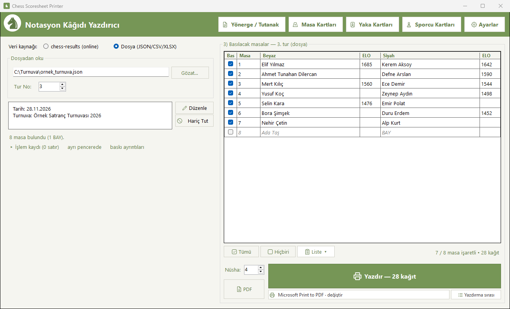
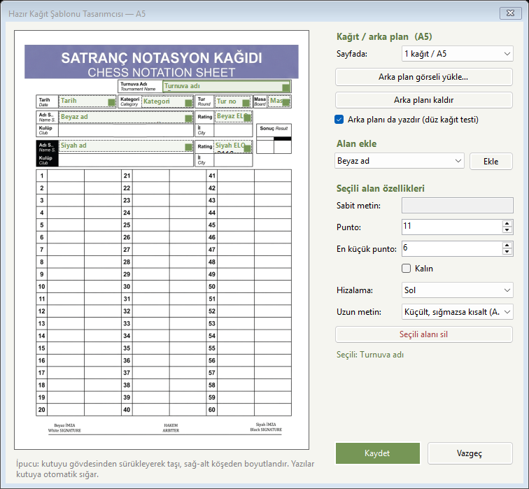

# Chess Scoresheet Printer

Türkçe | [English](README.en.md)

Chess Scoresheet Printer, turnuva eşleştirme bilgilerini hazır basılı satranç notasyon kâğıtlarına yerleştirmek ve yazdırmak için hazırlanmış bir Windows masaüstü aracıdır. Chess-Results ve Swiss-Manager çıktılarıyla çalışır.

Uygulama, iki TSF il temsilciliğinde yürütülen turnuvalarda kullanılmaktadır. Bağımsız bir projedir ve Türkiye Satranç Federasyonunun resmî uygulaması değildir.

  

## Temel işlevler

- Chess-Results üzerinden turnuva arama ve eşleştirme alma (BAY ve eşlenmeyen oyuncular ayrıştırılır)
- Kategori bazlı sistem desteği: İsviçre, Berger (döner) ve takım turnuvaları; sistem kategorinin "Turnuva Tipi" bilgisinden okunur
- Takım maçlarında "1.2" gibi masa numarası ve takım adları (kâğıttaki Kulüp kutularına)
- Sporcuların ili kâğıttaki "İl / City" kutusuna: ilin TSF sitesindeki turnuva kayıt listesi turnuva başında bir kez alınır ve saklanır; chess-results sporcularıyla Türkçe harf, ad sırası, eksik ikinci ad ve aynı adlı sporcular gözetilerek eşlenir
- Her kategorinin son turunu gösteren, tek tıkla o turu basan hızlı erişim düğmeleri (F5 hepsini yeniler)
- Salon panosu için A4 listeler: her kategorinin son turunun eşleştirme listesi (masa, oyuncular, rating, tur başı puan, tur saati) ve sonucu girilmiş son turun sonuçları ile o turdan sonraki sıralama; kategori başına küçük düğmeler ve "Tümü" (her kategori ayrı sayfa)
- Hakem eşleştirme kağıtları (Ctrl+H): Swiss-Manager çıktısından iri yazı, her masada sonucun yazılacağı kalın çerçeveli kutu, her kategorinin üstünde büyük ve kalın kategori adı ve tur; kategoriler ayrı sayfaya, sığdıkça aynı A4'e ya da seçilen sayfa gruplarına göre (ör. 3 kategori bir sayfaya, 2'si diğerine) dizilir; yazı boyutu seçilir, sayfa sayfa önizlenir; döner (Berger) kategorilerde bütün turlar bir kerede basılabilir (masa numaraları turdan tura değişmez). İsteğe bağlı ceza bildirim formu (adı soyadı, tarih, masa no, hamle no, tur, ceza nedeni, verilen ceza; hakem ad-soyad-imza): her sayfanın altında en çok yarım sayfa, silik kesik katlama çizgisiyle ayrılmış; ya da ayrı sayfa, boş veya işaretli kategorilerin basılan turlarındaki sporcularla (masa no, ad soyad, tur dolu); ayrı sayfada istenirse bir A4'e ortadan kesilecek iki form. Form satırları 1,2 cm: tükenmez kalemle rahat yazılır
- Turnuva henüz chess-results'ta yokken (eşleştirme yapılmadan, kayıtlar bitmiş olsa da) TSF kayıt formundaki sporcular "Basılacak masalar" alanında listelenir: kategoriye göre gruplu (grup başlığında sporcu ve masa sayısı) ya da kayıt sırasıyla; ad soyad, ELO, UKD, il ve kategori
- BAY masası varsayılan olarak basılmaz; yalnızca listede elle işaretlenirse basılır
- Turnuva yönergesi, raporu ve teknik toplantı tutanağı: gömülü şablonlar ya da kendi .docx şablonunuz chess-results verisi ve ilin TSF sitesindeki yönergeyle doldurulur; tüm alanlar tek tabloda düzenlenir; PDF, yazıcı veya Word çıktısı
- Tempoya göre resmi düşünme süresi önerisi (klasik, hızlı, yıldırım)
- TSF prosedürüne göre program ve kategori kontrolü: tempoya göre iki tur arası en az süre (ör. 35+30 → 150 dk), günlük tur sınırı (UKD 4, ELO 3; 2400+ ELO'da 90+30 ve 2 tur), 12 saat sınırı, kayıt kontrol süresi (30–60 dk), sporcu sayısına göre sistem/tur sayısı, kategorilerde tempo birliği, "Yaş ve Altı" kategorilerinin çift yaşta bitmesi; "Programı öner" ile tur saatleri otomatik hesaplanır
- Kategori masa kartları (A4 yatay): üstte turnuva afişi, altta büyük kategori adı; her kategorinin tema rengi ve iki stil (yazı renkli / beyaz zemin ya da zemin renkli / beyaz yazı); afiş kırpma aracı (kart yuvası, 16:9, 4:3, 1:1 ya da serbest) ve kenardan kenara tam genişlik seçeneği; gömülü yazı tipleri (Montserrat, Oswald, Inter); kategori adı tüm kartlarda aynı, hepsine sığan en büyük puntoda; adet kategorideki masa sayısı kadar önerilir
- Hakem yaka kartları (85×54 veya 90×60 mm yatay, A4'e 2×5 / 2×4; ya da büyük dikey 95×135 mm, A4'e 2×2, A6 kılıfa uyar; kesim işaretli): logo, fotoğraf, ad soyad, görev ve unvana göre renkli şerit
- Sporcu yaka kartı (95×135 mm, A4'e 2×2) ve masa isimliği (190×64 mm, A4'e 3 ya da 190×68 mm, A4'e 4): üstte turnuva afişi, ad soyad, kategori, okul / kulüp / il; yaka kartında iki yuvarlak logo ve afişin alt bandından şerit, isimlikte UKD ve ELO kutuları. Liste chess-results'tan (ELO, UKD ve il TSF kayıt listesiyle), TSF kayıt listesinden ya da Excel'den (eski yazdırma dosyalarının "Veri_Listesi" sayfası) alınır
- Yazıcı ayarları: hedef yazıcı, tepsi, kopya sayısı, yazıcının kendi tercihleri (sessiz mod, kalite) ve önizlemesiz "doğrudan yazdır"
- Kurulum ve güncelleme: program bir kez kurulur (masaüstü ve Başlat menüsü kısayolu, Ayarlar → Uygulamalar'dan kaldırılabilir). Açılışta (günde bir kez) yeni sürüm denetlenir; "⬆ Yeni sürüm" düğmesiyle yalnız değişen kısımlar (genelde birkaç MB) indirilir, ilerleme çubuğuyla gösterilir, doğrulanır ve program yeni sürümle yeniden açılır. Ayarlar, şablonlar ve çıktılar %APPDATA%\ChessScoresheetPrinter klasöründe kalır; güncelleme ve kaldırma bunlara dokunmaz
- JSON, CSV, TXT ve XLSX dosyalarını içe aktarma
- Basılacak masaları listeden işaretleyerek seçme (seçim her kategori ve tur için ayrı hatırlanır)
- Tur ve kategoriye göre toplu yazdırma
- Hazır notasyon kâğıtları için baskı şablonları oluşturma
- Alan konumlarını ve metin boyutlarını düzenleme
- Yazıcı hizalama (mm) ve hizalama test sayfası
- Masa hariç tutma, nüsha ve sayfa boyutu ayarları
- Kâğıdın soluk göründüğü baskı önizlemesi ve PDF çıktısı

## Kullanım

1. Chess-Results üzerinden bir turnuva seçin veya eşleştirme dosyasını açın. İl seçilince yalnız son 2 haftada biten, süren ve yaklaşan turnuvalar listelenir (daha eskileri adla aranır ya da numarasıyla açılır); ilin TSF sitesinde kayda açık olup chess-results'ta henüz bulunmayan turnuvalar da en üstte görünür: kaydı sürenler "📋 Kayıtta: … — 32 sporcu", kaydı yeni bitenler "📋 Kayıt bitti (23.10): …" olarak (durum ve sporcu sayısı her formun sayfasından okunur). Bilgisayarın DNS sunucusu TSF sitesinin adını çözemezse adres DNS-over-HTTPS ile (Cloudflare, yoksa Google; yalnız site adı gönderilir) bulunur. Böyle bir turnuva seçilince kategoriler ve sporcu sayıları TSF kayıt formundan gelir ve masa kartları bu sayılarla basılabilir; turnuva chess-results'ta yayımlanınca aynı kayıt listesi ona kendiliğinden bağlanır. İl seçildiğinde o ilin en son eklenen turnuvası kendiliğinden açılır; arama ve link/no ile de getirilebilir. **Ayarlar → Varsayılan il** seçiliyse program açılırken o il seçili gelir. İl listesinde harfe basmak o harfle başlayan ile, tekrar basmak sıradakine götürür.
2. Kategori ve turu seçin. Eşleştirmeler sağdaki listeye kendiliğinden gelir; varsayılan tur, eşleştirmesi yayımlanmış son turdur (Berger'de sonucu girilmemiş ilk tur). Hızlı erişim düğmesi (ör. "🖨 7 Yaş · T2") o kategorinin son turunu doğrudan baskıya gönderir. Yeni tur yayımlanınca F5 ile tüm düğmeler güncellenir.
3. Listede basılmayacak masaların işaretini kaldırın ve nüsha sayısını belirleyin (varsayılan 4). Seçimler hatırlanır; "Tüm Kategoriler" ve hızlı erişim düğmeleri de bu seçime uyar.
4. **Yazdır** (Ctrl+P) ile önizlemeyi açın. Önizlemede hazır kâğıt soluk görünür ama basılmaz. Yazıcıyı seçip basın; baskıdan sonra seçimler ve filtreler olduğu gibi kalır.

Başlıktaki **📄 Yönerge / Tutanak** düğmesi turnuva bilgilerini (tarih, yer, sistem, düşünme süresi, kategoriler, direktör, başhakem, hakemler, tur programı) chess-results'tan alır. Varsayılan ilin TSF sitesindeki (ör. isparta.tsf.org.tr) yönerge de bulunur ve içindeki son başvuru, iletişim, organizasyon ve program saatleri okunur. Hazır şablonlar "Turnuva Yönergesi", "Teknik Toplantı Tutanağı" ve "Turnuva Sonu Raporu"dur. Turnuva sonu raporu her kategorinin final sıralamasını chess-results'tan alır: kategori başına katılım ve oynanan tur, toplam sporcu ve katılan il sayısı, il dağılımı (TSF kayıt listesinden), her kategoride dereceye girenler (ilk üç) ve ekte tam final sıralamaları kendiliğinden dolar; aynı turnuva için girilen bilgiler tutanağa da aktarılır. Tüm alanlar tek tabloda düzenlenir, her alanın kaynağı yanında yazar. Kendi .docx şablonunuzu yükleyebilirsiniz: `{{IL}}`, `{{YER}}` gibi işaretler, Word yer imleri, içerik denetimleri ya da "İLİ | …" biçimindeki etiketli tablo hücreleri doldurulur; belgenin biçimi, tabloları ve kilitli alanları korunur. "Önizle ve Yazdır" belgeyi yazdırmadan önce sayfa sayfa gösterir; yazıcıya gönderme ve PDF kaydetme önizlemeden yapılır. **✏ Önizle ve Düzenle** belgeyi Word'deki gibi tam sayfa gösterir: doldurulacak alanlar sarı (boşsa kırmızımsı, "[Telefon]" gibi) işaretlidir; alana tıklayıp doğrudan yazılır (Enter tamam, Tab sonraki alan, F3 sonraki boş alan). Kategori, program ve diğer tabloların hücreleri de tıklanıp yerinde düzenlenir; **Ctrl+Z** son değişikliği geri alır, **Ctrl+Y** yineler. Başlıklar, logo ve şablonun sabit metni kilitlidir. Her değişiklikten sonra sayfa yaklaşık bir saniyede Word ile yeniden dizilir; yazılanlar tabloya da yansır ve yazdırma, PDF ve Word kaydı bu ekrandan da yapılır. PDF'e dönüştürme, önizleme ve yazdırma için Microsoft Word gerekir; Word yoksa belge .docx olarak kaydedilir. Hazır şablonlar: Turnuva Yönergesi, Teknik Toplantı Tutanağı, Turnuva Sonu Raporu, Ceza Tutanağı, İtiraz Tutanağı ve Hakem Görev Çizelgesi. Verilen cezalar ve yapılan itirazlar **📝 Ceza / itiraz kayıtları** penceresine yazılır (kategori, tur ve masa girilince sporcu eşleştirmeden gelir); ceza ve itiraz tutanakları ile turnuva sonu raporunun değerlendirmesi bunlarla dolar. **📦 Tutanak paketi** seçilen belgelerin hepsini tek seferde PDF olarak bir klasöre kaydeder. Kendi şablonunuzda işaret yazmanıza gerek yok: "İtiraz eden : ………" gibi noktalı yerler ve "Etiket | boş hücre" tablo satırları soru olarak gelir (Turnuva Adı, Tarih, Yeri, Başhakem gibi bilinen etiketler kendiliğinden dolar; imza yerleri dokunulmadan kalır). **📋 Kullanılabilir alanlar** tüm {{…}} işaretlerini ve hakem, sporcu, eşleştirme, ceza, itiraz tablolarını bu turnuvadaki değerleriyle gösterir.

**📋 Pano listeleri** (hızlı erişimin altında) iki satırdır: "Eşleştirme" satırındaki düğmeler kategorinin son eşlenen turunu ("Açık T5"), "Sonuç" satırındakiler sonucu girilmiş son turu gösterir ve o turun listesini A4 basar; sonuç listesinde o turdan sonraki sıralama da yer alır. "★ Tümü" tüm kategorileri her biri ayrı sayfada basar. Sağdaki masa listesinin altındaki **📋 Liste** menüsü ekranda seçili kategori ve turun eşleştirme ya da sonuç listesini basar (eski bir tur için de). Takım turnuvalarında masalar maç başlıklarıyla gruplanır. Kısayollar: **Ctrl+E** eşleştirme listesi, **Ctrl+R** sonuç listesi (ekranda seçili tur).

F5 ile yenileyince yeni turu eşlenen ya da sonucu girilen kategorilerin düğmeleri birkaç saniye turuncu yanar ve durum satırında "Yeni eşleştirme: 12 Yaş T6" gibi yazar. Sol alttaki işlem kaydı varsayılan olarak kapalıdır; "▸ İşlem kaydı" bağlantısıyla açılır (uyarı varsa bağlantı kırmızı görünür).

**Kayıt listesi ve iller** turnuva açılınca kendiliğinden alınır: ilin TSF sitesinde (ör. isparta.tsf.org.tr → Turnuva Kayıt) turnuvanın kayıt formu bulunur, liste programda saklanır ve kayıt kapandıktan sonra da kullanılır. Pencereye **⚙ Ayarlar → Bölge → 📋 Kayıt listesi ve sporcu illeri** düğmesinden ya da listedeki İl sütununa çift tıklayarak ulaşılır; başka bir form seçmek, listeyi yenilemek ya da bir ili düzeltmek için kullanılır. Hangi formun bu turnuvaya ait olduğu sporculardan anlaşılır: her formun kayıtlıları chess-results listesiyle karşılaştırılır ("38/44 sporcu bu turnuvada") ve yalnız eşleşenler işaretlenir; sporcuları uyuşmayan bir form bağlanmak istenirse uyarılır. Liste başka bir turnuva açıkken alınmışsa, başlığı bu turnuvayla eşleştiğinde kendiliğinden bu turnuvaya da bağlanır. TSF sitesine ulaşılamazsa daha önce alınmış liste kullanılır. Sporcular chess-results başlangıç listesiyle eşlenir: ad ve soyad birebir tutanlar "Kayıtta var", ikinci adı eksik ya da adında tek harf farkı olanlar "Benzer" (sarı), aynı adla farklı illerden kaydı olanlar "Belirsiz" (turuncu, il yazılmaz), bulunamayanlar gri gösterilir. Soyadı tutsa bile adı farklı olan (kardeş) eşlenmez; puan ve yaş kategorisi aynı adlıları ayırmakta kullanılır. İl tablodan elle değiştirilebilir; öğrenilen iller sonraki turnuvalarda kayıt listesi olmasa da önerilir. İl, hazır şablonlardaki "İl / City" kutusuna basılır.

**🏷 Masa Kartları** her kategori için A4 (varsayılan yatay) kart basar. Kart adedi turnuvanın TSF kayıt listesindeki sporcu sayısına göre önerilir (masa = sporcu ÷ 2; "15 Yaş Genel" ve "15 Yaş Kız" gibi kategoriler ayrı sayılır); kayıt listesi yoksa chess-results'taki masa sayısı kullanılır. Her kategoriye ayrı bir renk atanır ve hatırlanır; zemin ve yazı rengi tablodan değiştirilebilir. Kartın üstü içeriği kadar yer kaplar (afiş ya da turnuva adı sayfanın başından başlar, kalan yer kategori adına kalır). Kartlara T.C. Gençlik ve Spor Bakanlığı amblemi ve TSF il logosu (ikisi de yuvarlak, aynı boyda) basılır; TSF logosundaki il Ayarlar'daki ildir, Ayarlar → Bölge → Logo'dan genel TSF logosu da seçilebilir (il logoları programda üretilir, alt yaydaki il adı resmi logolardaki yazı tipiyle çizilir). **🎨 Kart tasarımı** ekranında logolar kartın üstünde sürüklenir, fare tekerleğiyle büyütülür; afiş bitişine, sayfa ortasına ve kenarlara kendiliğinden hizalanır. Hazır yerleşimler: başlıkta iki yanda, afiş bitişinde ortada, afiş bitişinde iki yanda, üst ve alt köşeler; tek logo seçilirse ortalanır. Yazılar logoların üstüne binmez. Seçili ilin logosu ana ekranın sol üst köşesinde ve (logo seçilmemişse) hakem yaka kartlarında da görünür.

**🎽 Sporcu Kartları** sporcu yaka kartı ve masa isimliği basar. Liste "⬇ chess-results" (her kategorinin başlangıç listesi; ELO, UKD ve il TSF kayıt listesiyle eşleştirilir), "⬇ TSF kayıt listesi" ya da "📄 Excel'den al…" ile gelir; Excel'de ad soyad, kategori, okul/kulüp/il, ELO ve UKD sütunları başlıktan tanınır (eski yazdırma dosyalarının "Veri_Listesi" sayfası doğrudan okunur). Tabloda düzeltilir, Excel'den kopyalanıp Ctrl+V ile yapıştırılabilir, kategoriye göre süzülür; seçilenler tek önizlemeden basılır ya da PDF'e kaydedilir. Afiş kırpılmadan basılır; "Afişin altından kırp" ile alttaki süs bandı kesilebilir, yaka kartında bu bant kartın altına şerit olarak konabilir. İsimlik için ayrı geniş şerit görseli seçilebilir; puanı olmayan sporcuda UKD/ELO kutusu basılmaz. Liste turnuvaya göre saklanır.

**🪪 Yaka Kartları** görevlileri chess-results'tan alır; unvan IA/FA/NA bilgisinden önerilir, TSF derecesi (Aday, İl, Ulusal, FIDE, Uluslararası) seçilebilir ve hatırlanır. Görev varsayılan olarak sade yazılır: başhakem "BAŞHAKEM", diğer tüm görevliler "HAKEM"; "Görevi sade yaz" kapatılırsa tablodaki görev (Başhakem Yardımcısı, Turnuva Direktörü…) aynen basılır. Büyük dikey kartta fotoğraf alanına her hakemin vesikalığı ya da tüm kartlarda aynı yatay görsel (turnuva afişi / bilgi) basılabilir; görsel kartın en üstüne kenardan kenara, kırpılmadan oturur.

**Ayarlar → Yazıcı** bölümünden hedef yazıcı, kağıt kaynağı ve kopya sayısı ayarlanır. **Yazıcı tercihleri…** yazıcının kendi ayar penceresini açar (sessiz mod, baskı kalitesi gibi üreticiye özel seçenekler); seçilenler her baskıda uygulanır. **Doğrudan yazdır** açıkken önizleme ve yazıcı penceresi açılmadan basılır. Aynı ayarlara ana ekranda **Yazdır** düğmesinin altındaki ince yazıcı satırından da ulaşılır; satır seçili yazıcıyı, tepsiyi ve doğrudan yazdırmanın açık olup olmadığını gösterir.

Yazılar hazır kâğıttaki kutulara göre kayıksa **Ayarlar → Yazıcı hizalama** bölümünden milimetre cinsinden düzeltin ve **Hizalama testi** ile tek kâğıt basarak kontrol edin; şablonu değiştirmeniz gerekmez. Turnuva yeri, hakem ve zaman kontrolü bilgileri bilinçli olarak kâğıda basılmaz. Tarih her şablonda 4 haneli yılla basılır (03.10.2026). İl kutusu A5'te de 81 ilin hepsini kesmeden basar; çok uzun iki il kısa adıyla yazılır (AFYON, K.MARAŞ).

Şablon düzenleyicisinde turnuva, tarih, kategori, tur, masa, oyuncu ve takım alanlarının konumu ayrı ayrı ayarlanabilir. Varsayılan şablon "Ana Örnek 2"dir; önceki yerleşim "Ana Örnek" adıyla durur. **Ayarlar → Sisteme göre şablon** ile İsviçre, Berger ve takım kategorileri için farklı şablon seçilebilir.

  

## İndirme

[Releases](https://github.com/TunahanDilercan/chess-scoresheet-printer/releases/latest) sayfasındaki `ChessScoresheetPrinter-win-Setup.exe` programı bilgisayara kurar (yönetici izni gerekmez; %LocalAppData% altına kurulur, masaüstü ve Başlat menüsüne kısayol konur). Sonraki güncellemeler program içinden, yalnız değişen kısımlar indirilerek yapılır. Kurulumsuz kullanmak isteyenler için `ChessScoresheetPrinter-win-Portable.zip` (kendini günceller) ve tek exe hâlinde `ChessScoresheetPrinter-vX.Y.Z-win-x64.zip` da vardır. Paketler .NET çalışma zamanını içerir; Windows 10 ve 11 içindir.

Dosyalar kod imzalı değildir: Setup tarayıcıyla indirildiğinde Windows ilk çalıştırmada bir kez "Windows bilgisayarınızı korudu" diyebilir (Ek bilgi → Yine de çalıştır). Kurulan program her açılışta sormaz. Program içinden yapılan güncellemeler ve tek exe'den kuruluma geçiş bu uyarıyı göstermez.

## Sorun giderme

- **Yazılar kâğıtta kayıyor:** Ayarlar → Yazıcı'dan kâğıt boyutunu ve tepsiyi denetleyin, ardından "Hizalama testi" sayfasını basıp ölçtüğünüz kaymayı mm olarak girin (±40 mm). A5 kâğıt A4 genişliğinde ayarlanmış bir tepsiye konursa ortalanmaz; tepsi kılavuzlarını kâğıda göre daraltın. Sol alttaki "baskı ayrıntıları" bağlantısı son baskının yazıcı, kâğıt, kenar boşluğu ve kaydırma bilgilerini gösterir.
- **Güncelleme yapılamadı:** Program değişmez; internet bağlantısını denetleyip yeniden deneyin ya da Releases sayfasından kurulum dosyasını indirip çalıştırın (ayarlar korunur).
- **Windows "bilgisayarınızı korudu" diyor:** Yalnız tarayıcıyla indirilen kurulum dosyasının ilk açılışında görülür: "Ek bilgi" → "Yine de çalıştır".
- **Program açık görünmüyor:** Aynı anda tek pencere açılır; ikinci açılış var olan pencereyi öne getirir.

## Veriler ve gizlilik

Ayarlar, şablonlar, eklenen afiş/logo/fotoğraflar, ceza ve itiraz kayıtları ile sporcu listeleri `%APPDATA%\ChessScoresheetPrinter` klasöründe tutulur; kurulum, güncelleme ve kaldırma bu klasöre dokunmaz. Program yalnız chess-results.com'dan turnuva bilgisini, ilin TSF sitesinden yönerge ve kayıt listesini, GitHub'dan da sürüm bilgisini okur; kişisel veri, yazıcı adı ya da çıktı hiçbir yere gönderilmez.

## Geliştirme

.NET 8 SDK ile `dotnet build` ve `dotnet test` çalıştırılır (Windows; testler WinForms bileşenlerini de kapsar). Sürüm paketleri `tools\release.ps1 -Version X.Y.Z -Notes notlar.md` ile hazırlanır: Velopack kurulum programı, tam ve fark paketleri, taşınabilir ZIP ve eski sürümlerden geçiş için tek exe'li ZIP ile SHA-256 dosyası `publish\release-vX.Y.Z\upload` klasörüne yazılır ve olduğu gibi GitHub sürümüne yüklenir. Fark paketi için önceki sürüm GitHub'dan kendiliğinden indirilir.
